# `win-cmd-rs` Architecture

`win-cmd-rs` is a single-crate Rust workspace (`#![forbid(unsafe_code)]`, sole runtime dependency `derive_more`) providing two tightly integrated engines over a shared, lossless parsing and virtual-filesystem foundation:

1. **`wincmd`** — A bug-for-bug, quirk-for-quirk cross-platform Windows Command Prompt (`cmd.exe`) interpreter.
2. **`wincheck`** — A `ShellCheck`-style 50-rule static analysis and lossless CST auto-fixing engine for `.bat`, `.cmd`, and interactive `cmd.exe` inputs.

---

## Table of Contents

1. [High-Level System & Module Dependency Graph](#1-high-level-system--module-dependency-graph)
2. [Why `cmd.exe` Is Not a POSIX Shell: The 5-Phase Streaming Pipeline](#2-why-cmdexe-is-not-a-posix-shell-the-5-phase-streaming-pipeline)
3. [Phase 0: Raw-Byte Cursor, Codepages & Span Provenance (`src/reader/`, `src/span.rs`)](#3-phase-0-raw-byte-cursor-codepages--span-provenance-srcreader-srcspanrs)
4. [Unified Lexer, Lossless CST & Dual-Mode AST Lowering (`src/parser/`)](#4-unified-lexer-lossless-cst--dual-mode-ast-lowering-srcparser)
5. [Multi-Pass Expansion & Quote/Caret State Machines (`phase1`–`phase4`)](#5-multi-pass-expansion--quotecaret-state-machines-phase1phase4)
6. [Runtime Engine & Domain Encapsulation (`src/runtime/`)](#6-runtime-engine--domain-encapsulation-srcruntime)
7. [Command Dispatch, Built-Ins, Shims & Deadlock-Free Spawning (`src/builtins/`)](#7-command-dispatch-built-ins-shims--deadlock-free-spawning-srcbuiltins)
8. [Virtual File System, Win32 Paths & Polynomial Globbing (`src/vfs/`)](#8-virtual-file-system-win32-paths--polynomial-globbing-srcvfs)
9. [`wincheck` Static Analyzer & Composable `CstRewriter` (`src/linter/`)](#9-wincheck-static-analyzer--composable-cstrewriter-srclinter)
10. [Unified `CmdError` Architecture & Verification Gates (`src/error.rs`, `tests/`)](#10-unified-cmderror-architecture--verification-gates-srcerrorrs-tests)

---

## 1. High-Level System & Module Dependency Graph

Every layer in `win-cmd-rs` is strictly acyclic: low-level location, domain, and error primitives (`span`, `types`, `error`) sit at the base; `reader`, `parser`, and `vfs` form the middle layer; `runtime`, `builtins`, and `linter` implement execution and static analysis; and `cli` plus the thin `src/bin/{wincmd,wincheck}.rs` entrypoints bind OS streams and arguments.

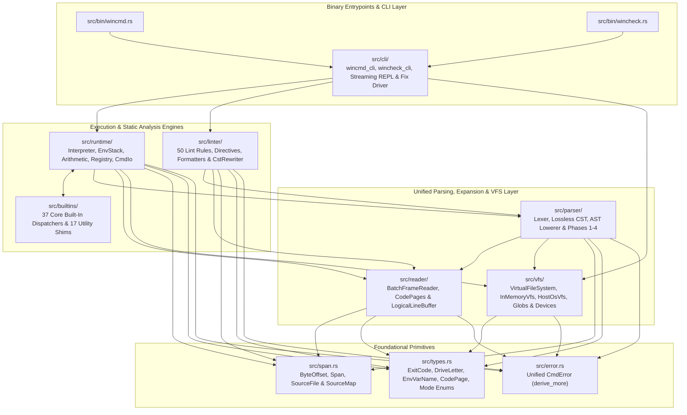

---

## 2. Why `cmd.exe` Is Not a POSIX Shell: The 5-Phase Streaming Pipeline

POSIX shells (`sh`, `bash`, `zsh`) parse an entire script or function into an AST before execution. Windows `cmd.exe` does **not**: it is a **stateful, raw-byte-offset macro processor** that fetches one statement (or one `( ... )` compound block) at a time from disk and runs four distinct expansion passes across each command’s lifecycle.

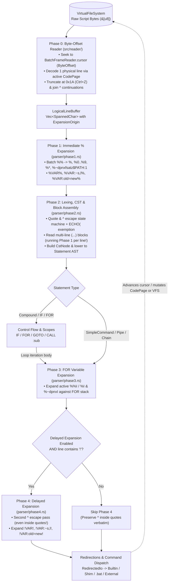

### Self-Modifying Scripts, `GOTO` & Mid-Script `CHCP`

Because `BatchFrameReader` stores its file position as a raw `ByteOffset` and re-reads from `VirtualFileSystem` before every statement, three classic `cmd.exe` behaviors emerge naturally without special-case hacks:
1. **Self-modifying batch files**: Appending lines to `"%~f0"` mid-execution causes the interpreter to read and execute the newly appended bytes once `cursor` reaches them.
2. **Mid-script `CHCP` switching**: Executing `CHCP 65001` updates `interp.console.codepage`; the very next physical line is decoded from its raw byte offset using UTF-8 without re-decoding earlier OEM bytes.
3. **`GOTO :label` byte scanning**: Label resolution scans raw bytes forward from `cursor` to EOF and wraps `[0..cursor)` just like `cmd.exe`.

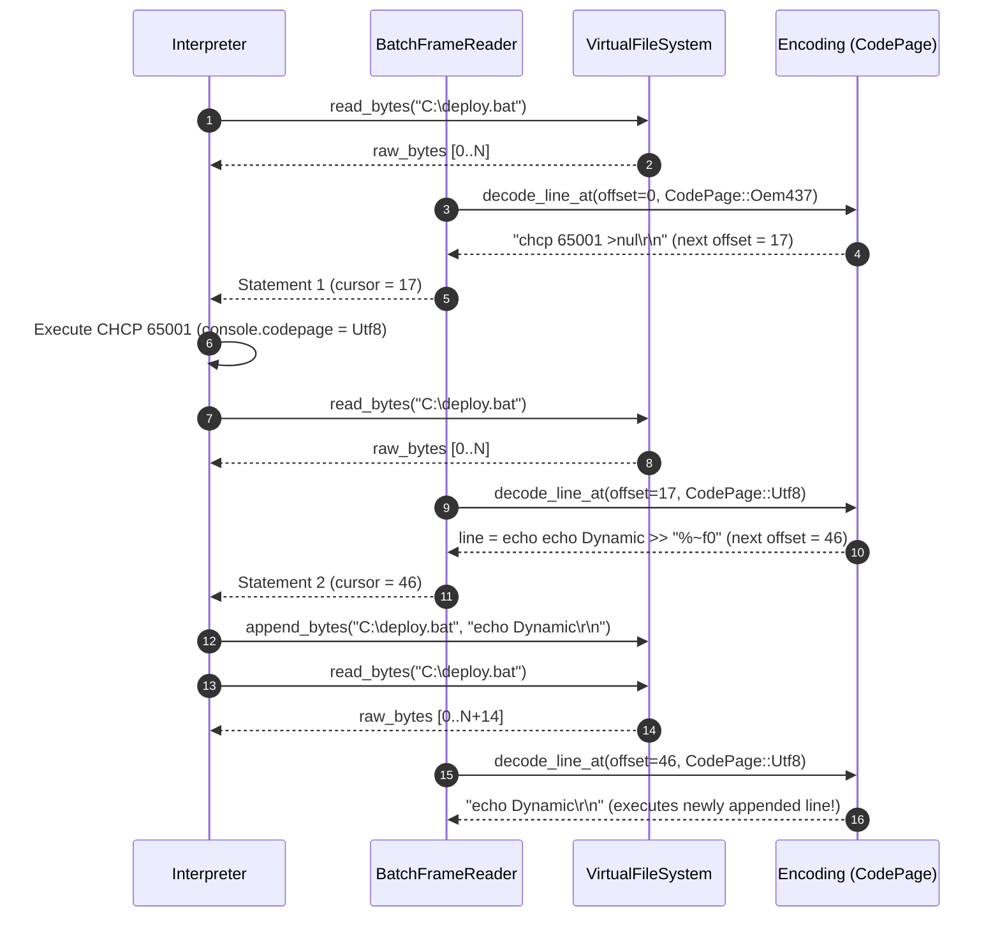

---

## 3. Phase 0: Raw-Byte Cursor, Codepages & Span Provenance (`src/reader/`, `src/span.rs`)

Every diagnostic in `wincheck` and every syntax error in `wincmd` maps expanded characters back to exact 1-based `(LineNumber, ColumnNumber)` coordinates in the original raw file—even after BOM stripping, `^\r\n` line continuations, and multi-pass variable expansions.

- **`SourceMap` & `SourceFile` (`src/span.rs`)**: Stores raw bytes, decoded text, precomputed newline byte offsets (`O(log L)` binary search for `line_col`), and BOM length (`UTF-8` 3-byte, `UTF-16LE/BE` 2-byte).
- **`CodePage` (`src/reader/encoding.rs`)**: Supports `Utf8` (`65001`), `OemUnitedStates` (`437`), `OemMultilingualLatin1` (`850`), `WindowsLatin1` (`1252`), `Utf16Le` (`1200`), `Utf16Be` (`1201`), and `Ascii` (`20127`), plus `0x1A` (`SUB` / `Ctrl+Z`) logical EOF truncation.
- **`ProvenanceMode` (`src/reader/char_map.rs`)**:
  - `ProvenanceMode::Full`: Tracks per-character `ExpansionOrigin` (`LiteralSource`, `CaretContinuation`, `PositionalParam`, `ImmediateEnvVar`, `ForVariable`, `DelayedEnvVar`).
  - `ProvenanceMode::Lightweight`: Elides heap `String` clones inside `ExpansionOrigin` on hot interpreter loops when sub-word provenance is not needed.

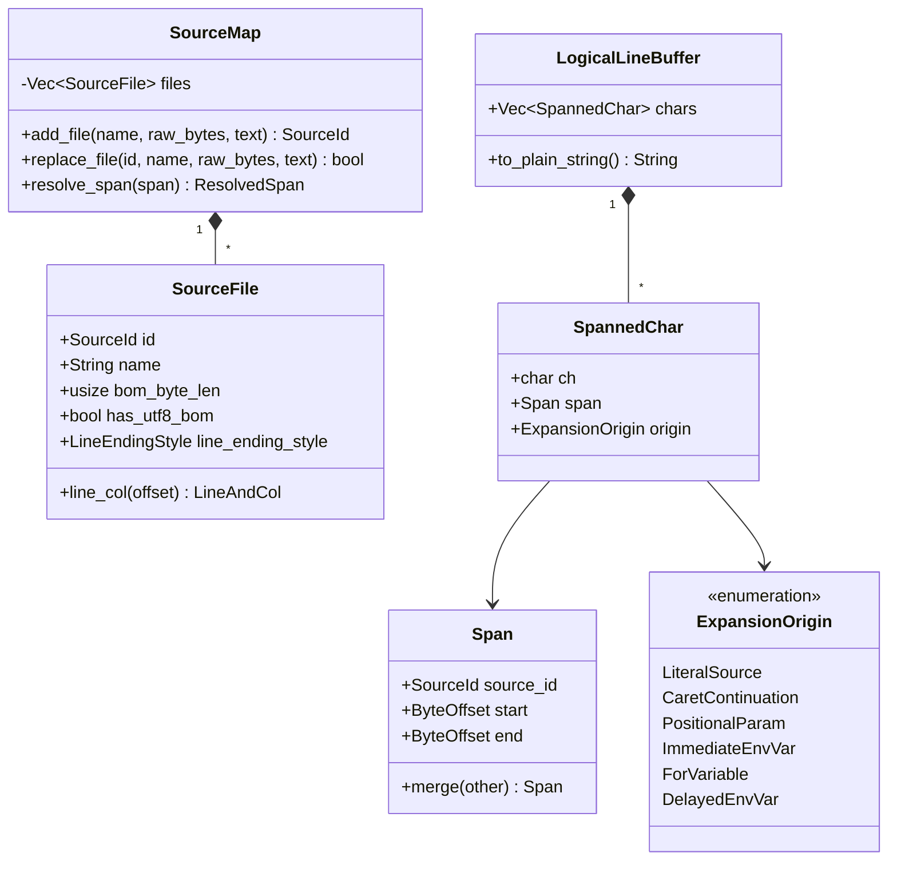

---

## 4. Unified Lexer, Lossless CST & Dual-Mode AST Lowering (`src/parser/`)

`wincmd` (strict execution) and `wincheck` (fault-tolerant static analysis & CST rewriting) share a **single unified parser pipeline** (`lexer.rs` -> `cst_parser/` -> `lower.rs`) so execution semantics and static analysis never drift apart:

1. **Shared Linear-Time Lexer (`src/parser/lexer.rs`)**:
   - Tokenizes statements, words, carets, quotes, `REM`/`::` comments, `ECHO(` delimiters, and top-level binary command operators (`&`, `&&`, `||`, `|`) in $O(N)$ time without backtracking.
2. **Lossless Concrete Syntax Tree (`src/parser/cst.rs`, `src/parser/cst_parser/`)**:
   - Guarantees the round-trip invariant `parse_script_cst(id, src, exec_context).to_source_string() == src` across arbitrary whitespace, UTF-8 BOMs, `CRLF`/`LF` line endings, `^` continuations, and syntax errors.
   - Runs internal statement parsing under `RecoveryMode::Strict` for `wincmd` execution and `RecoveryMode::Recovering` for `wincheck` (recovering from `IF a = b`, `IF (a == b)`, missing `IN`/`DO` in `FOR`, unparenthesized `ELSE`, unclosed `"`, and `%~dpVAR%` while recording `PegDiagnostic`s and farthest-failure expectations).
3. **Dual-Mode CST-to-AST Lowerer (`src/parser/lower.rs`)**:
   - `WordPartsMode::Lightweight`: Lowers CST to `Statement` AST for `wincmd` with zero sub-word `Vec<WordPart>` allocations.
   - `WordPartsMode::PopulateSubwordParts`: Populates rich sub-word `WordPart` tokens (`EnvVar`, `DelayedVar`, `PositionalParam`, `ForVar`, `Quoted`) for `wincheck` static analysis rules.

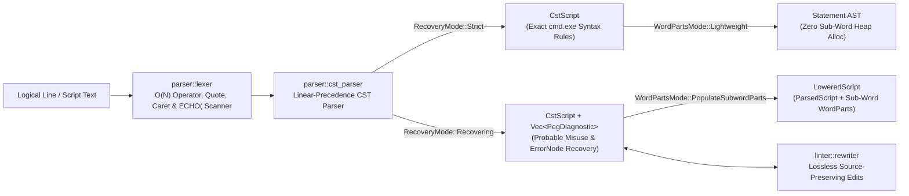

### CST & AST Node Hierarchy

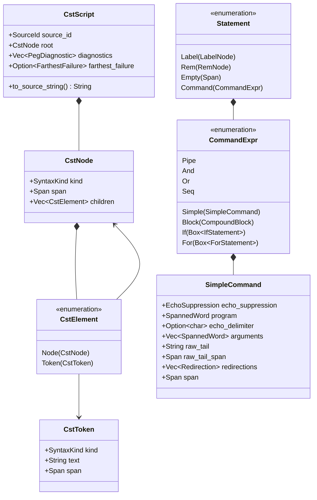

---

## 5. Multi-Pass Expansion & Quote/Caret State Machines (`phase1`–`phase4`)

Two state-machine subtleties are essential to authentic `cmd.exe` behavior:
1. **Phase 2 Quote vs. Caret Escaping**: Outside double quotes, `^` escapes the next character (`^&`, `^|`, `^>`, `^^`, `^"`). Inside `"..."`, `^` is treated as an **ordinary literal character** during Phase 2 (`"^&"` contains both `^` and `&`), and `""` represents an escaped quote.
2. **Phase 4 `!`-Triggered Second Caret Pass**: When `DelayedExpansionMode::Enabled` is active, `cmd.exe` scans the post-Phase-3 line for `!`. If **zero** `!` characters are present, Phase 4 does nothing at all! If **at least one** `!` is present anywhere on the line, Phase 4 runs a *second* `^` escape pass—this time honoring `^!` and `^^` **even inside double quotes**—while expanding `!VAR!`.

```mermaid
stateDiagram-v2
    [*] --> Phase2_Unquoted

    state "Phase 2 Tokenization State Machine" as P2 {
        Phase2_Unquoted --> Phase2_Caret : "Caret '^' seen"
        Phase2_Caret --> Phase2_Unquoted : "Emit escaped next char literally"
        Phase2_Unquoted --> Phase2_Quoted : "Quote (#quot;) seen -> QuoteMode::Quoted"
        Phase2_Quoted --> Phase2_Quoted : "'^', '&', '|', '(', ')' stay literal!"
        Phase2_Quoted --> Phase2_Unquoted : "Closing quote (#quot;) seen"
        Phase2_Unquoted --> OperatorSplit : "Unescaped &, &&, ||, |, <, >"
    }

    P2 --> Phase3_ForVars : "Expand %%I / %~dpI"
    Phase3_ForVars --> Phase4_Check

    state "Phase 4 Delayed Expansion Gate" as P4 {
        Phase4_Check --> FastSkip : "DelayedExpansion Disabled OR no '!' in line"
        Phase4_Check --> BangCaretScan : "DelayedExpansion Enabled AND line contains '!'"
        BangCaretScan --> ExpandBangVar : "Unescaped '!VAR!' -> live EnvironmentStack"
        BangCaretScan --> StripCaretEverywhere : "'^x' -> literal 'x' (even inside quotes!)"
    }

    FastSkip --> [*]
    ExpandBangVar --> [*]
    StripCaretEverywhere --> [*]
```

---

## 6. Runtime Engine & Domain Encapsulation (`src/runtime/`)

Rather than exposing raw mutable session fields on a monolithic god-struct, `Interpreter` is partitioned into four domain components with invariant-preserving accessors and configurable `ExecutionLimits`:

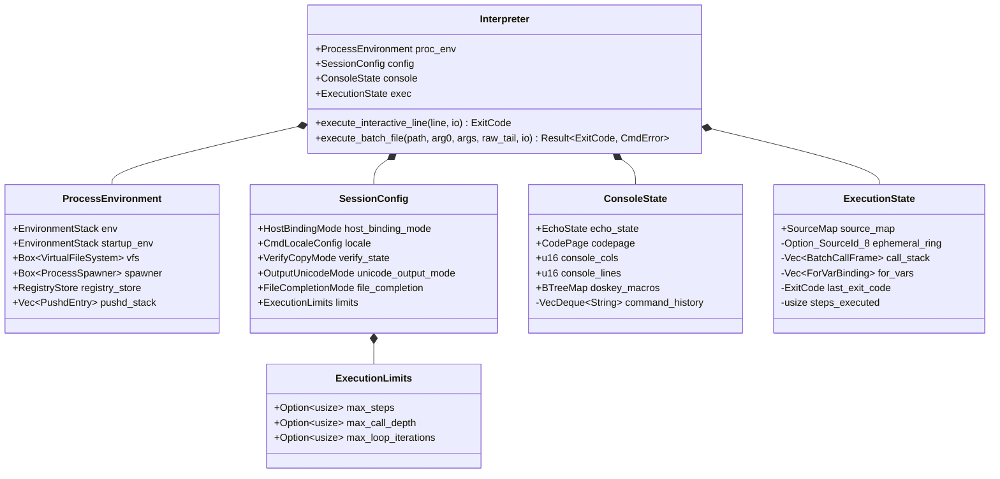

Key runtime design invariants:
- **Bounded `O(1)` Memory in Long-Running Sessions**: `ExecutionState` reuses an 8-slot ring buffer (`ephemeral_ring`) for interactive REPL, `CALL`, and `FOR /F` command strings, and reuses inactive `SourceId` slots per uppercase batch path (`batch_source_slots`) so calling `.bat` files in loops never leaks `SourceMap` entries. `ConsoleState` bounds `DOSKEY` history via a `VecDeque<String>`.
- **`SETLOCAL` / `ENDLOCAL` Stack (`src/runtime/env.rs`)**: `SETLOCAL` snapshots the current variable map, `ExtensionsMode`, `DelayedExpansionMode`, and active drive/CWD onto `EnvironmentStack`; `ENDLOCAL` (or exiting a `BatchCallFrame` via `:EOF` / `EXIT /B`) automatically unwinds all frames opened within that batch invocation.
- **Live `RegistryStore` Integration (`src/runtime/registry.rs`)**: `HKLM` and `HKCU` `Software\Microsoft\Command Processor` (`DelayedExpansion`, `EnableExtensions`, `DefaultColor`, `AutoRun`) and `HKCR` file associations (`ASSOC`, `FTYPE`) share a single canonical `RegistryStore` with the `REG` utility shim.

---

## 7. Command Dispatch, Built-Ins, Shims & Deadlock-Free Spawning (`src/builtins/`)

When a `SimpleCommand` reaches execution, `RedirectedIo` binds input/output file or stream redirections (`<`, `>`, `>>`, `2>&1`, `1>&2`, `NUL`, `CON`), and `dispatch_builtin` routes the command through a four-tier resolution chain:

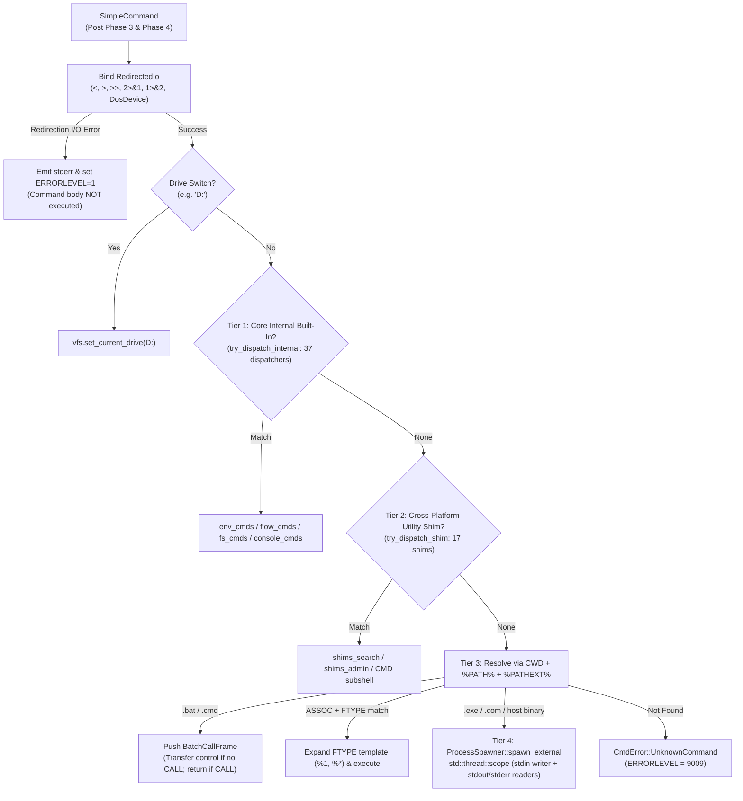

- **Zero-Copy VFS Sharing Across Pipelines (`cmd1 | cmd2`)**: Instead of deep-cloning `InMemoryVfs` for both sides of a pipe, `execute_pipeline` snapshots only per-drive CWDs (`VfsCwdSnapshot`), runs the left and right subshells with isolated `EnvironmentStack` and `ConsoleState` instances against the shared `VirtualFileSystem`, and restores the parent's CWD snapshot afterward.
- **Deadlock-Free Child Process Spawning (`HostProcessSpawner`)**: Uses `std::thread::scope` to concurrently stream `stdin` on a writer thread (closing child `stdin` immediately upon EOF) while draining `stdout` and `stderr` on two reader threads prior to `child.wait()`, preventing OS pipe buffer deadlocks on >64 KiB payloads.

---

## 8. Virtual File System, Win32 Paths & Polynomial Globbing (`src/vfs/`)

All filesystem operations in `reader`, `parser` (`%~dpnxfsatz$PATH:`), `runtime`, and `builtins` pass through the `VirtualFileSystem` trait—never `std::fs` directly—enabling deterministic cross-platform Windows path semantics on Linux, macOS, and Windows:

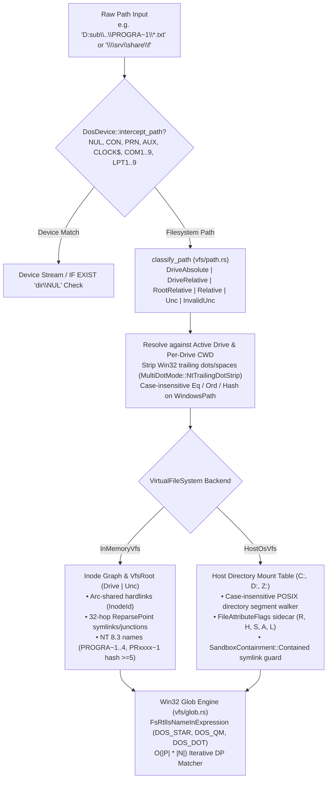

### Polynomial-Time Win32 Wildcard Engine (`src/vfs/glob.rs`)

Win32 wildcard rules (`FsRtlIsNameInExpression`) differ sharply from POSIX globs: `*.*` matches extensionless files, `*.` matches *only* extensionless files, and `?` (`DOS_QM`) matches 0 characters before `.` or end-of-name. `matches_win32_glob` evaluates both long filenames and 8.3 short filenames via an iterative dynamic-programming state vector in strictly $O(|P| \cdot |N|)$ worst-case time and $O(|N|)$ space, eliminating exponential backtracking on adversarial patterns like `*a*a*a*a*a*b`.

---

## 9. `wincheck` Static Analyzer & Composable `CstRewriter` (`src/linter/`)

`wincheck` combines file-level encoding/directive inspection, CST syntax-recovery diagnostics, AST semantic passes, and a 4-stage composable CST tree rewriter (`CstRewriter`). Crucially, **both `wincheck --diff` and `wincheck --fix` invoke the exact same `CstRewriter` pipeline**, guaranteeing 100% agreement between previewed diffs and rewritten scripts.

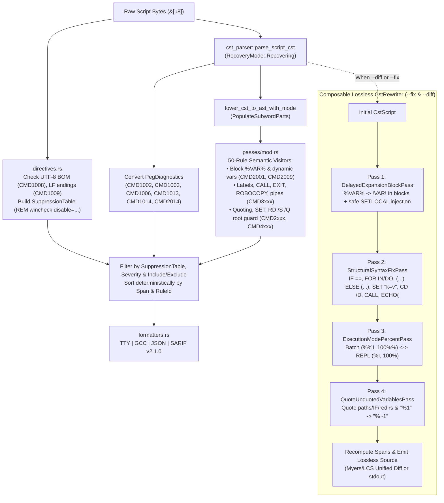

Why multi-pass CST re-parsing between rewrite stages matters:
- If Pass 2 repairs an unparenthesized `IF %x% = 1 echo %x% else echo no` into `IF %x% == 1 (echo(%x%) else (echo no)` and wraps `SET y = 2 ` into `SET "y=2"`, Pass 4 immediately sees the newly structured CST nodes without byte-offset collisions or corrupted spans, and `rewrite_script` is **idempotent** (`rewrite(rewrite(s)) == rewrite(s)`).

---

## 10. Unified `CmdError` Architecture & Verification Gates (`src/error.rs`, `tests/`)

Every fallible operation across all 61 source files (59 library modules and 2 binary entrypoints) returns `Result<T, CmdError>`—a single strongly typed enum powered by `derive_more::{Display, Error, From, IsVariant}` with zero `anyhow`, `thiserror`, or `Box<dyn Error>` erasure.

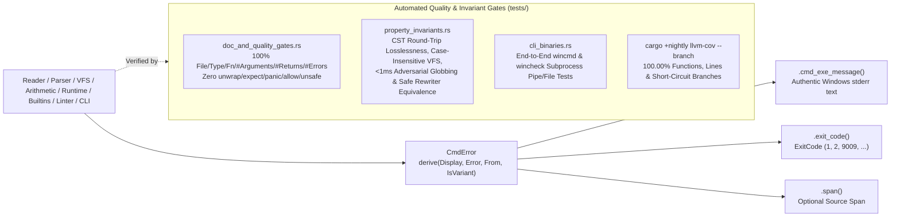
